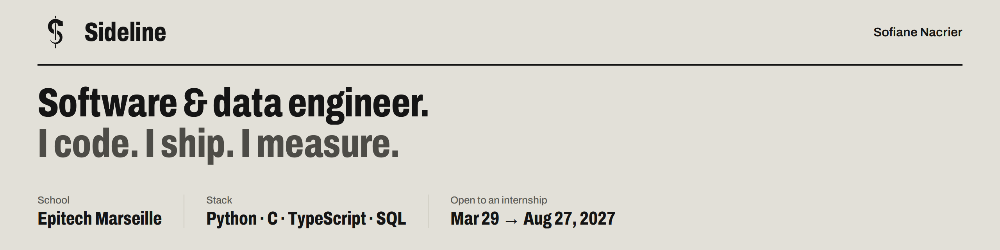

<picture>
  <source media="(prefers-color-scheme: dark)" srcset="header-dark.png">
  
</picture>

### Software engineer, moving into data engineering.

Third-year student at **Epitech Marseille**. I build systems end to end — from a multi-client game server in C to a full-stack web app on PostgreSQL — and I'm now focusing on data pipelines: ingestion, modeling, orchestration.

**Open to** a full-time internship · **March 29 → August 27, 2027**

---

#### Now

- **Sideline** — my company: a PWA for tracking sports activity on the field. Next.js, TypeScript, Supabase (PostgreSQL, Row Level Security), offline-ready. *Closed source.*
- **Data engineering** — building public pipeline projects with dbt, Dagster and Kafka.

#### Experience

- **Synethis** · Full-stack developer intern · 4 months, 2025
  User management and security platform: RBAC admin panel, password history with breach detection, security metrics dashboards, notifications. Python, Flask, SQLAlchemy.
- **BDE Epitech Marseille** · Communications lead
  Social media, visuals and promotion of student events.

#### Selected work

| Project | What | Stack |
|---|---|---|
| **Zappy** | Real-time multiplayer game server with `poll()` multiplexing, custom network protocol, autonomous AI client and 2D GUI | C, C++, SFML |
| **Lunar Lander RL** | DQN agent for autonomous landing, multi-seed training, ablations, reproducible pipeline and technical report | Python, PyTorch, Gymnasium |
| **E Corp bug bounty** | CTF challenges in a simulated company environment, vulnerability assessment, scripted PoCs | Python, security |

#### Stack

- **Languages** — Python · C · C++ · TypeScript · SQL
- **Web** — Next.js · React · Node.js · Flask · Supabase
- **Data & infra** — PostgreSQL · MySQL · MongoDB · Docker · Linux · Git

---

[sofiane.nacrier@epitech.eu](mailto:sofiane.nacrier@epitech.eu) · Marseille, France
